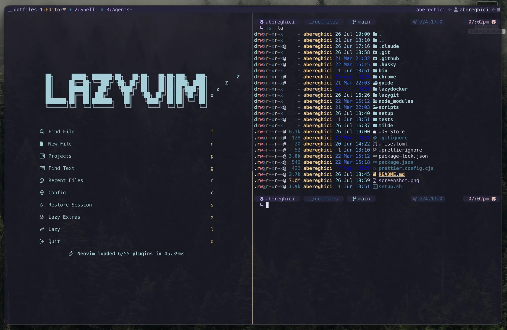

# ~abereghici 💻

My personal dotfiles for configuring macOS with Zsh and Homebrew.

<!-- prettier-ignore -->
> [!IMPORTANT]
> Please only open pull requests that fix bugs or add improvements without any
> breaking changes.



<!-- prettier-ignore -->
> [!WARNING]
> I recommend forking this repository to create your own set of dotfiles.

## Requirements

- macOS
- Homebrew (the install script will install Homebrew)
- Zsh (the default shell on modern macOS)

## What's in there?

- Handy [binary scripts](bin/).
- Project pickers for tmux and herdr ([`projects`](bin/projects)).
- [Custom zsh theme](tilde/.starship.toml) with Git branch, etc. using
  [Starship](https://starship.rs/).
- [Git aliases](tilde/.gitconfig).
- [Shell aliases](tilde/.config/zsh/aliases.zsh).
- zsh / [fzf](tilde/.config/zsh/fzf.zsh).
- git / delta syntax-highlighting diff tool.
- Language runtimes via [mise](tilde/.config/mise/config.toml).
- Sensible [macOS defaults](setup/macos.sh).
- [Neovim](tilde/.config/nvim/)
- [VS Code](vscode/) settings and snippets (default keybindings); extensions are
  the `vscode` entries in the [Brewfile](setup/Brewfile).
- [macOS apps](setup/Brewfile) I use.

## Installation

1. Enable **Firewall** under **System Settings** → **Network**
1. Point the DNS Servers to [Cloudflare DNS](https://one.one.one.one/dns/)
   - `1.1.1.1`
   - `1.0.0.1`
   - `2606:4700:4700::1111`
   - `2606:4700:4700::1001`
1. Configure Git and GitHub SSH

   1. [Generate SSH key and add it to the ssh-agent](https://docs.github.com/en/authentication/connecting-to-github-with-ssh/generating-a-new-ssh-key-and-adding-it-to-the-ssh-agent)
   1. [Add your public SSH key to GitHub account](https://docs.github.com/en/authentication/connecting-to-github-with-ssh/adding-a-new-ssh-key-to-your-github-account)
   1. Test your authentication with:

      ```bash
      ssh -T git@github.com
      ```

1. Choose _manual_ or _automatic_ dotfiles installation below

### Manually

```shell
git clone git@github.com:abereghici/dotfiles.git ~/dotfiles
cd ~/dotfiles
./setup/brew.sh
./setup/symlinks.sh
./setup/misc.sh
```

`misc.sh` runs after `symlinks.sh` because it reads the linked mise, bat and
tmux configs.

### Automatically

To automate the setup of your dotfiles on a new machine, use the
[setup](./setup.sh) script.

<!-- prettier-ignore -->
> [!CAUTION]
> Use at your own risk!

```shell
git clone git@github.com:abereghici/dotfiles.git ~/dotfiles
~/dotfiles/setup.sh
```

This will install all required dotfiles in your home directory as symlinks.
Everything is then configured via modifying files in `~/dotfiles`.

## Extras

### Set macOS defaults

```shell
./setup/macos.sh
```

#### Keyboard conflicts

- Turn off the Mission Control "Move left/right a space" shortcuts (`Ctrl` +
  `←`/`→`): Neovim uses them to resize windows.

### Raycast

Raycast keeps its hotkeys in an encrypted database, so they are set by hand and
recorded here. Hyper (`⌃⌥⇧⌘`) is reserved for Raycast: nothing else in these
dotfiles binds it.

1. **System Settings** → **Keyboard** → **Keyboard Shortcuts…** → **Modifier
   Keys**: leave Caps Lock as **Caps Lock**, otherwise Raycast can't use it.
1. **Raycast Settings** → **Keyboard** → **Hyper Key**: **Caps Lock**, with
   **Include Shift** on (to match the Voyager's Hyper) and **Quick Press** set
   to **Trigger Escape**.
1. Record each hotkey below under **Raycast Settings** → **Shortcuts**.

| Hotkey      | Command                         |
| ----------- | ------------------------------- |
| `⌘ Space`   | Raycast                         |
| `Hyper` `V` | Clipboard History               |
| `Hyper` `W` | Improve Writing (Claude Writer) |

To move the settings to another Mac, run **Export Settings & Data**, then
**Import Settings & Data** on the new one. Keep the encrypted `.rayconfig` out
of this repository: it can include clipboard history, notes and AI chats.

### Romanian

[`keyboard/ABC-Romanian.keylayout`](keyboard/ABC-Romanian.keylayout) is the
macOS ABC layout with the Romanian Programmers keys (SR 13392:2004) on Option.
`symlinks.sh` links it into `~/Library/Keyboard Layouts` and runs
[`setup/input-source.swift`](setup/input-source.swift), which makes **ABC –
Romanian** the only keyboard layout (ABC is disabled). If it reports that the
layout isn't registered yet, log out and back in and run `setup/symlinks.sh`
again. Edits to the layout take effect after the next login.

| Keys          | Types   |
| ------------- | ------- |
| `⌥` `A` / `Q` | ă / â   |
| `⌥` `I`       | î       |
| `⌥` `S` / `T` | ș / ț   |
| add `⇧`       | capital |

Ghostty uses the left Option as Alt, so its config types the same letters on
those keys; zsh's Alt bindings on them don't fire there.

On a Mac without these dotfiles, pick the built-in **ABC – Extended**: `⌥` `B`
then `A` for ă, `⌥` `6` then `A`/`I` for â/î, `⌥` `P` then `S`/`T` for ș/ț.

### Project pickers

[`projects`](bin/projects) opens a project as a tmux session or a herdr
workspace, from tmux (`prefix` `f`, `⌃⌥P`), herdr (the same keys) or the shell
(`tmuxs`, `herdrs`). It picks from the folders inside `~/Development` and
`~/Code` and inside their `Work/` folder, whichever exist, so machines with
different folders need no config. `prefix` `g` creates a project folder first.
Run `projects` on its own to list the roots it found.

### tmux or herdr

[herdr](tilde/.config/herdr/config.toml) is set up as a drop-in for
[tmux](tilde/.config/tmux/tmux.conf): the same `⌥Space` prefix, the same keys
(tmux sessions are herdr workspaces, windows are tabs) and the same Rosé Pine
look. `prefix` `Tab` / `⌃⌥O` (last session) comes from the
[last-workspace plugin](herdr/plugins/last-workspace/), which `misc.sh` links.
On top of tmux, `prefix` `a` jumps to the agent that needs attention and
`prefix` `/` searches every pane. New projects open with nvim already running in
their Editor tab, and after a restart herdr brings back every workspace, tab and
directory, with the [editor-restore plugin](herdr/plugins/editor-restore/)
starting nvim again in Editor tabs (tmux-resurrect's job in tmux).

### Reviewing agent changes

- In herdr, `⌃⌥R` (or `prefix` `V`) toggles
  [reviewr](https://github.com/persiyanov/herdr-reviewr) beside the agent:
  `u`/`b`/`t` for uncommitted, branch or the agent's last turn, `v` and `c` to
  comment on lines, `s` to send the comments to the agent, `?` for every key.
- In Neovim, [CodeDiff](tilde/.config/nvim/lua/plugins/codediff.lua) is a VS
  Code-style live diff where hunks can be staged or discarded: `<leader>gd` for
  uncommitted changes, `<leader>gD` for the branch against the default branch,
  `<leader>gH` for history.

## Local customizations

The dotfiles can be extended to suit additional local requirements by using the
following files:

None of them are checked in.

### `~/.zsh.local`

If this file exists, `.zshrc` sources it after the path, env, aliases,
keybindings and completion setup, and before the plugins and the prompt. Its
content can add to or overwrite the existing aliases, settings, PATH, etc.

```zsh
# Extra binaries for this machine only
[ -d "$HOME/.acme/bin" ] && PATH="$HOME/.acme/bin:$PATH"

# Secrets from the macOS Keychain (stored with `keychain set ACME_API_KEY`)
eval "$(keychain export ACME_API_KEY)"
```

### `~/.gitconfig.local`

If this file exists, it is included at the end of `~/.gitconfig`, so its content
can overwrite or add to the existing `git` configurations.

<!-- prettier-ignore -->
> [!TIP]
> Use `~/.gitconfig.local` to store sensitive information such as the `git` user
> credentials for individual repositories.

```ini
# A different identity for every repository under ~/Code/Work/
[includeIf "gitdir:~/Code/Work/"]
  path = ~/.gitconfig.work
```

with `~/.gitconfig.work`:

```ini
[user]
  email = you@example.com
```

### `~/.config/mise/config.local.toml`

[mise](https://mise.jdx.dev/) loads it alongside `config.toml` (see
`mise config ls`), for runtimes and tools you only need on this machine. Since
`~/.config/mise` links to `tilde/.config/mise`, the file lives there and is
git-ignored.

```toml
[tools]
terraform = "latest"
```

### `~/.config/herdr/reviewr.local.toml`

Extra [reviewr](tilde/.config/herdr/reviewr.toml) settings for this machine,
such as a work GitLab host for the PR tab. reviewr reads a single `config.toml`,
so run `herdr-reviewr-config` after editing it to write that file from
`reviewr.toml` and this one. Like the mise file, it lives in
`tilde/.config/herdr` and is git-ignored.

```toml
gitlab_host = "git.example.com"
```

### `~/.macos.local`

[`setup/macos.sh`](setup/macos.sh) sources it for personal settings; each one is
skipped when unset.

```bash
COMPUTERNAME='my-mac'
LOCALHOSTNAME='my-mac'
LANGUAGES=(en)
LOCALE='en_US'
TIMEZONE='Europe/London' # list: sudo systemsetup -listtimezones
```

## Updating

To update an existing install:

```shell
cd ~/dotfiles
git pull
./setup.sh
```

## License

MIT License.

## Inspiration

- [nicksp/dotfiles](https://github.com/nicksp/dotfiles)
- [holman/dotfiles](https://github.com/holman/dotfiles)
- [mathiasbynens/dotfiles](https://github.com/mathiasbynens/dotfiles)
- [sapegin/dotfiles](https://github.com/sapegin/dotfiles)
- <https://remysharp.com/2018/08/23/cli-improved>
- <https://evanhahn.com/a-decade-of-dotfiles>
- <https://cpojer.net/posts/set-up-a-new-mac-fast>
- <https://thevaluable.dev/zsh-install-configure-mouseless/>
