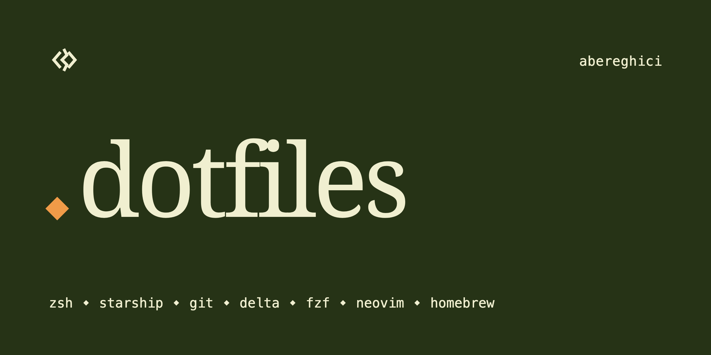

# ~abereghici

[](https://github.com/abereghici/dotfiles/actions/workflows/ci.yml)
[](LICENSE)


My macOS dotfiles: Zsh, Homebrew, Neovim (LazyVim), Ghostty, tmux and herdr for
coding agents, lazygit, mise and AeroSpace. Every themed tool uses Bereghici
Dark or Light and follows the macOS appearance. One script sets up a new Mac;
the configs are symlinks back into this repository, so editing them here is
editing them live.

<!-- prettier-ignore -->
> [!WARNING]
> These are my personal settings, and `setup.sh` changes your system (see
> [what it changes](#what-setupsh-changes)). Fork the repository and review the
> code before running it, rather than installing it as is.

## Contents

- [What's inside](#whats-inside)
- [Requirements](#requirements)
- [Install](#install)
- [Local customizations](#local-customizations)
- [Updating](#updating)
- [Uninstalling](#uninstalling)
- [Troubleshooting](#troubleshooting)
- [More docs](#more-docs)
- [Contributing](#contributing)
- [License](#license)
- [Credits](#credits)

## What's inside

| Area     | Tools                                                                                                                                                                     |
| -------- | ------------------------------------------------------------------------------------------------------------------------------------------------------------------------- |
| Shell    | [Zsh](tilde/.zshrc) with [aliases](tilde/.config/zsh/aliases.zsh), [fzf](tilde/.config/zsh/fzf.zsh), zoxide, direnv and a [Starship prompt](tilde/.starship.toml)         |
| Terminal | [Ghostty](tilde/.config/ghostty/config), [tmux](tilde/.config/tmux/tmux.conf) and [herdr](tilde/.config/herdr/config.toml) on one prefix ([keys](docs/herdr-and-tmux.md)) |
| Editor   | [Neovim](tilde/.config/nvim/) on LazyVim; [VS Code](vscode/) settings and snippets with default keybindings                                                               |
| Git      | [Git aliases](tilde/.gitconfig), delta diffs and [lazygit](lazygit/config.yml)                                                                                            |
| Runtimes | Node, Python, Go, Rust, Java, Bun, Maven and uv via [mise](tilde/.config/mise/config.toml)                                                                                |
| Theme    | Bereghici Dark/Light from [abereghici/themes](https://github.com/abereghici/themes), switched by [`appearance`](bin/appearance) ([how](docs/appearance.md))               |
| macOS    | [Defaults](setup/macos.sh) ([notes](docs/macos.md)), [AeroSpace](tilde/.config/aerospace/aerospace.toml) tiling and a [Romanian keyboard layout](keyboard/README.md)      |
| Apps     | Everything in the [Brewfile](setup/Brewfile), VS Code extensions included                                                                                                 |
| Scripts  | [`bin/`](bin/), including the [`projects`](bin/projects) picker for tmux and herdr and [`keychain`](bin/keychain) for secrets                                             |

The repository is laid out by where things go: [`tilde/`](tilde/) is linked into
`~`, [`bin/`](bin/) into `~/.local/bin`, and the rest by
[`setup/`](setup/README.md) ([`herdr/plugins/`](herdr/plugins/),
[`keyboard/`](keyboard/), [`lazygit/`](lazygit/), [`vscode/`](vscode/),
[`launchd/`](launchd/)). [`tests/`](tests/) checks the result.

## Requirements

- macOS 14 (Sonoma) or later; tested on macOS 26 on Apple silicon. The Homebrew
  paths for Intel Macs are handled but not tested.
- An administrator account (`setup.sh` uses `sudo`).
- Git, from the Xcode Command Line Tools (`xcode-select --install`); the
  Homebrew installer also offers them.

## Install

```shell
git clone https://github.com/abereghici/dotfiles.git ~/dotfiles
~/dotfiles/setup.sh
```

It asks you to press Enter and for your password, then what to do with any file
in the way and the local settings questions. Pass `-y` for no questions at all:
every file in the way is backed up, and the
[local settings](#local-customizations) are skipped (run `setup/local.sh`
later). Open a new terminal when it's done. Setting up a new Mac? See the
[checklist](docs/new-mac.md) for what to do around it.

### What `setup.sh` changes

In order, each step a script you can also run on its own:

1. **`~/.zshrc`**: moved to `~/.zshrc.backup` if it's a real file (a timestamp
   is added when that backup exists).
1. **`/etc/pam.d/sudo_local`**: created, if missing, so Touch ID can authorize
   `sudo`.
1. [`setup/brew.sh`](setup/brew.sh): installs Homebrew if needed, runs
   `brew update` and `brew upgrade`, installs the [Brewfile](setup/Brewfile) and
   runs `brew cleanup`.
1. [`setup/symlinks.sh`](setup/symlinks.sh): links `tilde/`, `bin/`, the
   lazygit, lazydocker and VS Code configs and the keyboard layout. A file in
   the way is skipped, overwritten or backed up, as you choose (backed up with
   `-y`), and links left pointing at removed files are deleted. It also installs
   the [appearance agent](docs/appearance.md) in `~/Library/LaunchAgents`.
1. [`setup/local.sh`](setup/local.sh): asks for this machine's private settings
   and writes the [`*.local` files](#local-customizations), mode 600. Skipped
   with `-y`.
1. [`setup/misc.sh`](setup/misc.sh): installs tpm and the tmux plugins, links
   the [herdr plugins](herdr/plugins/) and installs
   [herdr-reviewr](https://github.com/persiyanov/herdr-reviewr), installs the
   mise runtimes and npm packages, clones (or updates)
   [abereghici/themes](https://github.com/abereghici/themes) into
   `~/.local/share/bereghici` and runs its `install.sh`, then `appearance sync`.

[`setup/README.md`](setup/README.md) describes each script in detail. A step
that fails, such as one Brewfile entry or an offline clone, is reported and the
rest goes on; re-running `setup.sh` is safe. The optional
[`setup/macos.sh`](docs/macos.md) writes macOS defaults and is not part of
`setup.sh`.

## Local customizations

These optional files extend the dotfiles for one machine and are never checked
in. [`setup/local.sh`](setup/local.sh) writes them from your answers; every
question can be left empty, and a file that exists is kept (delete it to be
asked again).

### `~/.zsh.local`

Sourced by `.zshrc` after the path, env, aliases, keybindings and completion
setup, and before the plugins and the prompt, so it can add to or override any
of them. `local.sh` writes the Keychain secrets you name into it, storing their
values in the Keychain, never in a file.

```zsh
# Extra binaries for this machine only
[ -d "$HOME/.acme/bin" ] && PATH="$HOME/.acme/bin:$PATH"

# Secrets from the macOS Keychain (stored with `keychain set ACME_API_KEY`)
eval "$(keychain export ACME_API_KEY GITHUB_TOKEN)"
```

### `~/.gitconfig.local`

Included at the end of `~/.gitconfig`, so it can override or add to any setting.
`local.sh` writes your name, email and GitHub username, the optional
HTTPS-to-SSH rewrite for GitHub, and a separate identity for a work Git host:
any repository whose remote is on that host includes `~/.gitconfig.work`.

```ini
[user]
  name = "Your Name"
  email = "you@example.com"
[includeIf "hasconfig:remote.*.url:https://git.example.com/**"]
  path = ~/.gitconfig.work
```

### `~/.config/mise/config.local.toml`

[mise](https://mise.jdx.dev/) loads it alongside `config.toml` (see
`mise config ls`), for tools you only need on this machine. `~/.config/mise`
links to `tilde/.config/mise`, so the file lives there, git-ignored.

```toml
[tools]
terraform = "latest"
```

### `~/.config/herdr/reviewr.local.toml`

Settings for [herdr-reviewr](https://github.com/persiyanov/herdr-reviewr), such
as a work GitLab host. [`herdr-reviewr-config`](bin/herdr-reviewr-config) merges
it with [`reviewr.toml`](tilde/.config/herdr/reviewr.toml) into reviewr's
config; run it again after editing either.

```toml
gitlab_host = "git.example.com"
```

### `~/.macos.local`

Personal settings for [`setup/macos.sh`](setup/macos.sh); each one is skipped
when unset.

```bash
COMPUTERNAME='my-mac'
LOCALHOSTNAME='my-mac'
LANGUAGES=(en)
LOCALE='en_US'
TIMEZONE='Europe/London' # list: sudo systemsetup -listtimezones
```

## Updating

```shell
cd ~/dotfiles
git pull
./setup.sh -y
```

`-y` skips the questions, which an update doesn't need. Every step is safe to
run again: links already in place are skipped, and the Homebrew packages, mise
tools and themes are brought up to date. Plugins already installed keep their
version: update them with `herdr plugin update` and tpm's `prefix` `U`.

## Uninstalling

```shell
~/dotfiles/setup/uninstall.sh -n # print what it would remove
~/dotfiles/setup/uninstall.sh
```

[`setup/uninstall.sh`](setup/uninstall.sh) removes the links into this
repository and into the themes, the appearance agent and the herdr plugins
linked from here, lists the backups `setup.sh` made (restore them with `mv`),
and asks before removing `/etc/pam.d/sudo_local`. Homebrew and its packages, the
themes clone, the `*.local` files and any macOS defaults stay.

## Troubleshooting

- **A command or setting is missing after setup**: open a new terminal; the
  running one predates the links.
- **`brew` isn't found after installing Homebrew by hand**: run
  `eval "$(/opt/homebrew/bin/brew shellenv)"`, or open a new terminal.
- **Two quick `⌥Space` presses open Claude's Quick Entry**: Claude desktop opens
  it on a double tap of `⌥`; set its shortcut to something else in its Settings.
- **`⌃` + arrows switch Spaces instead of resizing Neovim splits**: turn off the
  [Mission Control shortcuts](docs/macos.md#keyboard-shortcut-conflicts).
- **A tool didn't switch theme with the appearance**: run `appearance sync`
  ([details](docs/appearance.md)).
- **Is everything in place?** `npm test` runs the [bats tests](tests/) against
  this machine; they change nothing.

## More docs

- [herdr and tmux keys](docs/herdr-and-tmux.md)
- [Theme and appearance](docs/appearance.md)
- [macOS defaults, shortcut conflicts and Raycast](docs/macos.md)
- [Romanian keyboard layout](keyboard/README.md)
- [Chrome theme and extensions](chrome/README.md)
- [New Mac checklist](docs/new-mac.md)
- [The setup scripts](setup/README.md)

## Contributing

Pull requests that fix bugs or add improvements without breaking changes are
welcome. See [CONTRIBUTING.md](CONTRIBUTING.md) for the checks to run, and
[SECURITY.md](SECURITY.md) to report a vulnerability privately.

## License

[MIT](LICENSE) © Alexandru Bereghici

## Credits

Ideas and structure from these repositories and articles:

- [nicksp/dotfiles](https://github.com/nicksp/dotfiles)
- [holman/dotfiles](https://github.com/holman/dotfiles)
- [mathiasbynens/dotfiles](https://github.com/mathiasbynens/dotfiles), the base
  of [`setup/macos.sh`](setup/macos.sh)
- [sapegin/dotfiles](https://github.com/sapegin/dotfiles)
- <https://remysharp.com/2018/08/23/cli-improved>
- <https://evanhahn.com/a-decade-of-dotfiles>
- <https://cpojer.net/posts/set-up-a-new-mac-fast>
- <https://thevaluable.dev/zsh-install-configure-mouseless/>
